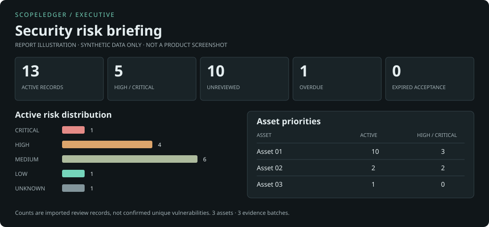

# ScopeLedger Executive

**Offline security review & risk governance**

`v0.2.0 · Development preview` &nbsp; | &nbsp; `Local-first` &nbsp; | &nbsp; `Planned one-time license`

Turn authorized configuration reviews and existing scanner reports into an actionable risk register and concise executive briefing. ScopeLedger complements specialist scanners and professional security assessment.

[Sample executive briefing (GitHub-readable)](SAMPLE_EXECUTIVE_REPORT.md) · [Exported HTML report](sample-executive-report.html) · [Product overview (HTML source)](index.html) · [한국어 소개](README.ko.md)

## One workflow, three decision layers

| Portfolio | Evidence | Governance |
| --- | --- | --- |
| Asset-level risk priorities, ownership, due dates, active review queue | 22 heuristic configuration checks; limited SARIF 2.1.0, Trivy JSON schema 2, Gitleaks JSON and legacy ScopeLedger report imports | Human triage, acceptance expiry, decision rationale, internal CSV/JSON and alias-based executive HTML summaries |

- Review imported findings without running external scanners from ScopeLedger.
- Separate evidence coverage, business criticality, severity and human review decisions.
- Preserve source fingerprints and exportable workspace checksums.
- Operate in a local browser session without a required cloud service or account. Manual backup is required.

## Explore the preview

The sample briefing is an actual export from the development version using **synthetic demonstration records**. The graphic above is a visualization of that report, not a screenshot. This public repository contains promotional material and sample reports only; the full application and scanner source are not distributed here.

## Availability and licensing

A commercial one-time license is planned; no recurring subscription is planned. **Checkout and the paid release are not active yet.** No orders or payments are accepted through this repository.

For non-sensitive product feedback, use [GitHub Issues](https://github.com/alphastartix26-ops/scopeledger-local/issues). Do not post customer data, secrets or vulnerability evidence. See [Security policy](SECURITY.md).

## Evaluation boundaries

Counts are review records, not unique or confirmed vulnerabilities. Imports cover limited report schemas; local checks are heuristic. No live CVE feed, endpoint agent, SSO/RBAC, centrally encrypted storage or authenticated multi-user audit. Local checksums are not digital signatures. No enterprise certification, independent penetration test, production adoption, or security guarantee is claimed. Use only authorized data and review exports before sharing.

© ScopeLedger project. Commercial terms will be published before paid release. No open-source license for the commercial application is granted by this repository.
